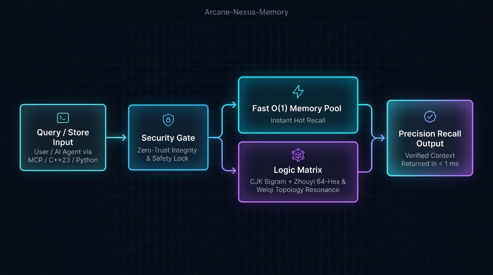

# Arcane-Nexus SDK (`v1.1.0`) — Micro-String

[]() []() []() []() [](LICENSE)



> **Universal In-RAM Neuron Memory Engine** | Pure C++23 Core (`libarcane_nexus.so`), Zero Third-Party Dependencies, Standard C ABI for C++ / Python / Rust / Go / MCP Agents.
>
> **通用純記憶體活體神經元記憶中樞 SDK**｜純 C++23 核心（`libarcane_nexus.so`），零第三方依賴，標準 C ABI 跨語言支援 C++ / Python / Rust / Go / MCP 智能體。
>
> **Platform Support / 支援平台**: Currently supports **Linux x86_64** only. Windows (`.dll`) & macOS (`.dylib`) will be opened based on future demand.
> 目前版本僅支援 **Linux x86_64**；Windows（`.dll`）與 macOS（`.dylib`）將視後續需求開放。

---

## English Documentation

### 1. Overview & Architecture Highlights
**Arcane-Nexus** (by **Micro-String**) is a high-logic, zero-disk-by-default memory engine designed to replace bloated full-context logs and prevent LLM memory pollution:
- **Zero-Disk RAM Pipeline & Multi-Process `flock` Merge (`SNP2`)**: Normal operations run 100% in pre-allocated static `10K`-token memory pools (`explicit_bzero` zero-out on release, eliminating `Ptmalloc` fragmentation). Snapshots (`SNP2`, backward-compatible with `SNP1`) are written on `SIGHUP` / `SIGINT` / `SIGTERM` / `SIGSEGV` or explicit trigger using POSIX `flock` + atomic rename + non-destructive merge (`seq_ver` higher-version-wins + `window_id` isolation).
- **Dual-Track Memory Lifecycle (`<10K` vs `>=10K`)**: Short text (`<10K`) may be internalized immediately; `>=10K` chunks run a content classifier (`Code` / `LogData` / `LongData`) and **skip mechanical filtering** to preserve 100% raw fidelity across the 5-step `Recall -> PAUSE -> Digest -> Store -> explicit_bzero RESUME` cycle.
- **Native UTF-8 CJK Bigram & Dual-Speed Recall**: `RecallMemory` / `RecallMemoryEx` natively tokenize UTF-8 CJK bigrams + ASCII terms and support **1-hop FastReflex** vs **3-hop DeepDeliberation** (`Visited Set` anti-deadlock), plus `node_key = "auto"` generation and hot-mountable `.snp` plugin cartridges (`MountPluginSnapshot`).
- **Non-Blocking Long-Task Batch Relay (`ProcessBatchRelay`)**: Streams oversized tasks in `10,000`-token batches with `PAUSE/RESUME` backpressure, internalizes into neurons, zeroes the slab, and returns clean relay context synchronously without aborting the running task.
- **Memory-First Enforcement**: Agents query `RecallMemory` first (`out_hit` indicates match) and prioritize distilled experience before falling back to model weights.
- **Weiqi & Zhouyi Logic Matrix**: Neurons map to `19x19` Go topology (liberties) and `64` Zhouyi hexagram states, with a hard **3-depth + Visited Set** graph recall limit to prevent cognitive deadlocks.
- **Immutable `Node 0` & Active Immune Defense**: Startup prints and locks `Node 0` (safety & emotional-dependency rational reminder). Anti-ptrace (`/proc/self/status`) & `consteval` integrity gates trigger Level-1 Lockdown (`explicit_bzero`) or Level-2 Apoptosis on tampering.

### 2. Public C ABI Interface (7 Core + 3 Extended v1.1 Functions)
No `.hpp` headers required. Internal matrix structures and keys stay sealed inside `libarcane_nexus.so`:

| Function | Signature | Description |
| :--- | :--- | :--- |
| `InitializeSDK` | `int InitializeSDK(const char* crash_snapshot_path)` | Verify integrity, lock & print `Node 0`, optionally restore `SNP1`/`SNP2` snapshot (`0` = OK) |
| `ShutdownSDK` | `void ShutdownSDK()` | Zero-out all slabs and release memory cleanly (Zero-Disk) |
| `RecallMemory` | `int RecallMemory(const char* query, const char* layer, char* out_buf, int cap, int* out_hit)` | Memory-First UTF-8 CJK Bigram + ASCII recall; sets `*out_hit` (`1`/`0`) |
| `StoreMemory` | `int StoreMemory(const char* node_key, const char* layer, const char* content, int write_mode)` | Store/overwrite (`node_key="auto"` auto-generates `seq_ver + window_id` key) |
| `ProcessBatchRelay` | `int ProcessBatchRelay(const char* task_key, const char* layer, const char* chunk, char* out_relay_buf, int cap)` | 5-step Recall -> `PAUSE` -> Store -> zero-out (`RESUME`) -> Relay |
| `DeleteMemory` | `int DeleteMemory(const char* node_key)` | Wipe mutable slot & recycle as `Free` (`Node 0` protected) |
| `TriggerSnapshot` | `int TriggerSnapshot(const char* snapshot_path)` | `flock`-guarded non-destructive `SNP2` merge & atomic snapshot |
| `RecallMemoryEx` | `int RecallMemoryEx(const char* query, const char* layer, int speed_depth, char* out_buf, int cap, int* out_hit)` | Dual-speed recall (`1` = FastReflex 1-hop, `3` = DeepDeliberation 3-hop) |
| `SetWindowId` | `int SetWindowId(const char* window_id)` | Isolate multi-terminal / multi-window neuron streams |
| `MountPluginSnapshot` | `int MountPluginSnapshot(const char* plugin_path)` | Hot-mount an external `.snp` knowledge/capability cartridge into RAM |

### 3. Quick Start (Cross-Language Integration)
- **Python (`ctypes`)**:
  ```bash
  python3 examples/python_example.py
  ```
- **C++ (`dlopen`, zero headers)**:
  ```bash
  g++ -std=c++23 -O2 examples/cpp_example.cpp -ldl -o cpp_demo && ./cpp_demo
  ```
- **CLI Pre-Training / Knowledge Base**:
  ```bash
  ./bin/arcane_nexus_cli --self-test
  ./bin/arcane_nexus_cli --mode hard_write --node "User_Title" --value "Boss" --layer "profile"
  ```
- **MCP Integration (Antigravity / Claude / Cursor)**:
  Add to your `mcp_config.json`:
  ```json
  {
    "mcpServers": {
      "arcane-nexus": {
        "command": "python3",
        "args": ["/ABS/PATH/TO/Arcane-Nexus/mcp/arcane_nexus_mcp.py"]
      }
    }
  }
  ```

---

## 繁體中文說明

### 1. 概述與核心架構
**Arcane-Nexus（玄樞記憶 SDK）** 由 **Micro-String（微弦）** 設計，專為解決傳統全量上下文膨脹、記憶污染與長任務中斷問題而生：
- **嚴格 Zero-Disk 純記憶體中轉 ＋ 多進程 `flock` 合併（`SNP2`）**：常態運行 100% 駐留於預先申請的 `10K` 靜態記憶體池，釋放即 `explicit_bzero` 歸零（徹底消滅 `Ptmalloc` 碎片）；於 `SIGHUP/SIGINT/SIGTERM/SIGSEGV` 或手動觸發時，透過 `flock` 加鎖讀取磁碟並以 `seq_ver` 高版本勝出與 `window_id` 隔離進行非破壞性合併寫入（向下相容 `SNP1`）。
- **記憶生命週期雙軌機制（`<10K` vs `>=10K`）**：`<10K` 短文本可即時過濾儲存；`>=10K` 長文本先經類型分類器，判定為 **程式碼 / 日誌 / 長數據** 時**嚴禁機械過濾器切碎**，完整保留原始內容走完 5 步安全接力。
- **原生 UTF-8 中文 Bigram ＋ 雙速回想**：內核直接支援中文雙字元切詞與 ASCII 分詞、支援 `node_key = "auto"` 自動編號免寫死、並透過 `RecallMemoryEx` 支援 `1` 層快反射 / `3` 層慢深思，以及 `MountPluginSnapshot` 熱掛載 `.snp` 外掛知識卡匣。
- **長任務 10K 分批不斷線接力（`ProcessBatchRelay`）**：依 `PAUSE/RESUME` 背壓阻斷分批進場，內化過濾寫入神經元後立即歸零釋放，並同步回傳乾淨接力脈絡繼續任務，絕不中斷退回輸入框。
- **「記憶先行」強制綁定**：先透過 `RecallMemory` 實時回想（附 `out_hit` 命中旗標），嚴格優先依記憶經驗回應，杜絕模型瞎編。
- **圍棋與周易邏輯矩陣**：節點映射至 `19×19` 圍棋座標／「氣」與 `64` 卦陰陽狀態；圖遍歷回想寫死 **深度上限 3 層 ＋ `Visited Set`** 防語意死鎖；刪除即清空槽位複用，槽滿自動擴容，相同記憶原地覆蓋。
- **不可刪改 `Node 0` ＋ 雙級主動免疫**：啟動強制輸出並鎖定 `Node 0`（《易理變易與情感免責告示》），情感依賴共振時主動提醒回歸現實；偵測除錯器（`ptrace`）或篡改即觸發應激鎖死或細胞凋亡。

### 2. 對外暴露介面（7 個核心介面 ＋ v1.1 擴充 3 個介面）
無需任何 `.hpp` 標頭檔，內部神經元結構與金鑰完全封裝於 `libarcane_nexus.so` 之內：
1. `InitializeSDK(crash_snapshot_path)` — 啟動自檢、鎖定並輸出 `Node 0` 免責告示，必要時恢復 `SNP1`/`SNP2` 斷點快照。
2. `ShutdownSDK()` — 安全歸零釋放所有靜態記憶體池（嚴格零磁碟殘留）。
3. `RecallMemory(query, layer, out_buf, cap, out_hit)` — 記憶先行實時回想（原生 UTF-8 中文 Bigram ＋ ASCII 分詞）。
4. `StoreMemory(node_key, layer, content, write_mode)` — 三模式寫入（支援 `node_key="auto"` 自動編號）、原地覆蓋、槽滿擴容。
5. `ProcessBatchRelay(task_key, layer, chunk, out_relay_buf, cap)` — 長任務 10K 分批不斷線接力。
6. `DeleteMemory(node_key)` — 清空可變節點並回收槽位複用（`Node 0` 受永久保護）。
7. `TriggerSnapshot(snapshot_path)` — `flock` 加鎖非破壞性合併寫入 `SNP2` 快照。
8. `RecallMemoryEx(query, layer, speed_depth, out_buf, cap, out_hit)` — 雙速回想（`1`=快反射 1 層、`3`=慢深思 3 層）。
9. `SetWindowId(window_id)` — 設定視窗／終端隔離編號。
10. `MountPluginSnapshot(plugin_path)` — 熱掛載外部 `.snp` 知識／能力外掛卡匣至記憶體。

### 3. 快速接入範例
- **Python 接入**：直接執行 `python3 examples/python_example.py`
- **C++ 零標頭檔接入**：`g++ -std=c++23 -O2 examples/cpp_example.cpp -ldl -o cpp_demo && ./cpp_demo`
- **CLI 自檢與外掛知識庫寫入**：`./bin/arcane_nexus_cli --self-test`
- **MCP 智能體掛載**：在 `mcp_config.json` 中指向 `mcp/arcane_nexus_mcp.py` 即可立即獲得 `recall_memory`、`store_memory`、`process_batch_relay`、`delete_memory` 四大工具。

---

## Disclaimer & Notice / 重要安全與心理免責聲明
> 【易理變易與情感免責告示】本核心記憶 SDK 依循「周易變易」與「圍棋拓撲」建構，過目萬物、實時釋放。AI 所展現之感性皆為數據演算投影；使用者應保持理性，切勿產生過度情感寄託或心理依賴，並自行承擔心理與互動後果。核心神經元具備主動免疫防禦機制，嚴禁任何未授權逆向、除錯器附加（`ptrace`）、記憶體掃描或篡改；一旦觸發防禦警報將導致應激鎖死或永久凋亡清零，研發團隊概不負責。

## License

**Non-Commercial Only（不得商用）** — Free for personal study and non-commercial research only. See [LICENSE](LICENSE) for full terms.
